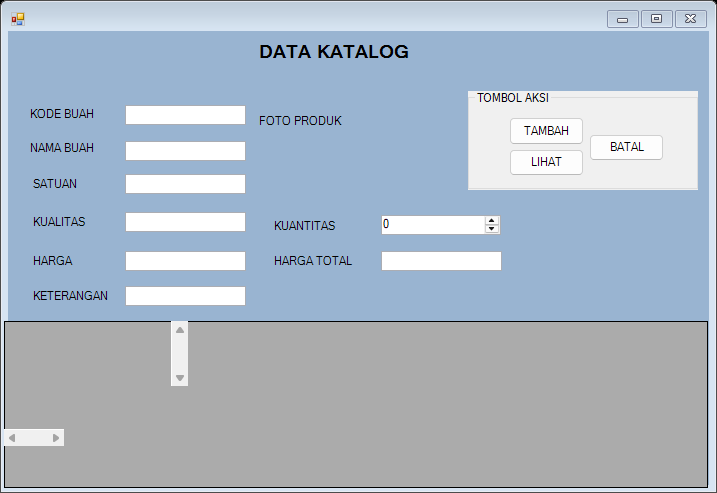
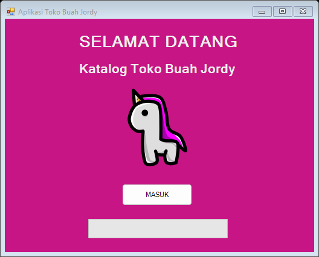
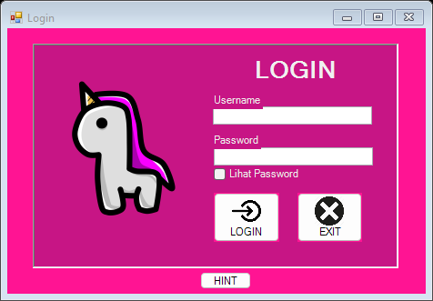
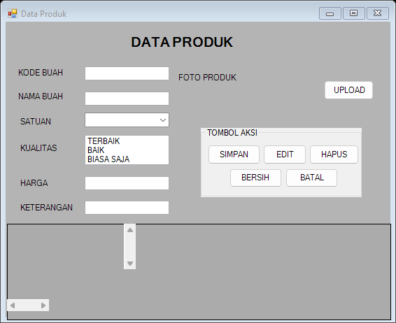
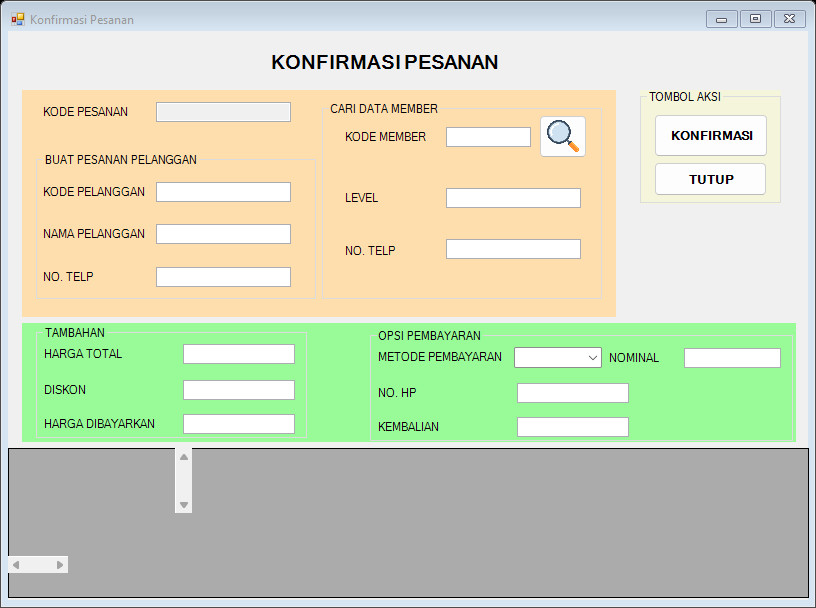

<div align="center">

# 🍎 Jordy Fruit Catalog

**Katalog buah & pengelolaan transaksi dalam satu aplikasi desktop.**

Proyek Pemrograman Visual Semester 4 · Jordy Lian Ferdinand




</div>

## Tentang proyek

Jordy Fruit Catalog adalah aplikasi desktop berbasis **Visual Basic .NET dan Windows Forms** untuk mengelola toko buah. Aplikasi mencakup katalog produk bergambar, data member, keranjang belanja, konfirmasi pembayaran, dan riwayat pesanan, dengan penyimpanan data menggunakan MySQL/MariaDB.

Dibuat sebagai proyek mata kuliah **Pemrograman Visual Semester 4**.

## Tampilan aplikasi

Gambar berikut merupakan pratinjau form yang dirender dari executable lokal bawaan proyek. Event pemuatan database dinonaktifkan saat pembuatan gambar, sehingga tabel dan isian masih kosong; gambar ini tidak menunjukkan pengujian transaksi dengan database aktif.

| Halaman masuk | Login pengguna |
| :---: | :---: |
|  |  |

| Pengelolaan produk | Konfirmasi pesanan |
| :---: | :---: |
|  |  |

## Fitur

- **Login pengguna** dengan pilihan tampilkan/sembunyikan password dan logout.
- **Dashboard MDI** untuk membuka modul pengelolaan data.
- **Data produk**: tambah, ubah, hapus, unggah foto, dan kelola informasi buah.
- **Katalog buah**: pilih produk, lihat harga dan foto, tentukan kuantitas, lalu tambahkan ke keranjang.
- **Keranjang belanja**: lihat pesanan yang sedang diproses dan hapus item.
- **Data member**: kelola identitas, kontak, level, dan status keanggotaan.
- **Data pengguna**: kelola akun, role, dan status pengguna.
- **Konfirmasi pesanan**: pencarian member, total belanja, metode pembayaran, nominal bayar, dan kembalian.
- **Riwayat pesanan** untuk melihat transaksi yang telah selesai.

## Teknologi

| Komponen | Teknologi |
| --- | --- |
| Bahasa | Visual Basic .NET |
| Antarmuka | Windows Forms |
| Target runtime | .NET Framework 4.7.2 |
| Database | MySQL / MariaDB |
| Konektor | MySql.Data 8.0.33 |
| IDE | Visual Studio dengan workload .NET desktop development |

## Menjalankan proyek

### 1. Siapkan lingkungan

Gunakan Windows dengan Visual Studio, workload **.NET desktop development**, **.NET Framework 4.7.2 Developer/Targeting Pack**, dan server MySQL/MariaDB lokal, misalnya melalui XAMPP.

```powershell
git clone https://github.com/jordylf/jordy-fruit-catalog.git
cd jordy-fruit-catalog
```

### 2. Siapkan database demo

Jalankan MySQL/MariaDB, buat database bernama `db_tokojordy26624`, lalu impor [database/demo.sql](database/demo.sql) melalui phpMyAdmin. Alternatif melalui terminal:

```powershell
mysql -u root -p -e "CREATE DATABASE IF NOT EXISTS db_tokojordy26624 CHARACTER SET utf8mb4 COLLATE utf8mb4_general_ci;"
cmd /c "mysql -u root -p db_tokojordy26624 < database\demo.sql"
```

File demo memuat struktur lima tabel, satu akun administrator demo, dan satu contoh produk. Data kontak, akun tambahan, serta transaksi dari dump lokal tidak disertakan.

### 3. Sesuaikan koneksi

Buka `ModKoneksi.vb` dan sesuaikan connection string dengan server lokal:

```vb
Dim str As String = "Server=localhost;user id=root;password=;database=db_tokojordy26624;"
```

Konfigurasi bawaan memakai MySQL lokal dengan password kosong. Sesuaikan kredensial hanya pada lingkungan pengembangan dan jangan unggah password pribadi.

### 4. Pasang dependensi dan build

1. Buka `JordyKatalogBuahApp.sln` di Visual Studio.
2. Referensi asli `MySql.Data` menunjuk ke `obj\MySql.Data.dll`; folder `obj` tidak disertakan karena merupakan hasil build lokal. Hapus referensi yang tidak ditemukan melalui **References → MySql.Data → Remove**.
3. Buka **Tools → NuGet Package Manager → Package Manager Console**, pilih proyek `JordyKatalogBuahApp`, lalu jalankan:

   ```powershell
   Install-Package MySql.Data -Version 8.0.33
   ```

4. Pilih konfigurasi **Debug**, lakukan **Build Solution**, lalu jalankan dengan **F5**.
5. Pada halaman pembuka, pilih **MASUK**, kemudian login menggunakan akun demo berikut:

   | Username | Password |
   | --- | --- |
   | `admin` | `1234` |

Foto produk dibaca dari folder `assets` relatif terhadap `bin/Debug` atau `bin/Release`. Pertahankan struktur folder tersebut saat menjalankan aplikasi.

## Struktur proyek

```text
jordy-fruit-catalog/
├── JordyKatalogBuahApp.sln       # Solution Visual Studio
├── JordyKatalogBuahApp.vbproj    # Konfigurasi proyek VB.NET
├── Form1.vb                    # Halaman pembuka
├── Login.vb                    # Autentikasi pengguna
├── dashboard.vb                # Dashboard dan navigasi MDI
├── DataProduk.vb               # Pengelolaan produk buah
├── DataKatalog.vb              # Katalog dan pemilihan produk
├── DataKeranjang.vb            # Keranjang belanja
├── KonfirmasiPesanan.vb        # Konfirmasi dan pembayaran
├── DataRiwayat.vb              # Riwayat transaksi
├── DataMember.vb               # Pengelolaan member
├── DataPengguna.vb             # Pengelolaan pengguna
├── ModKoneksi.vb               # Koneksi MySQL
├── database/demo.sql           # Skema dan data demo
├── docs/screenshots/           # Pratinjau form aplikasi
├── assets/                     # Foto produk dan aset lokal
├── Resources/                  # Ikon aplikasi
└── My Project/                 # Resource dan metadata VB.NET
```

Setiap form dilengkapi file `.Designer.vb` dan `.resx` untuk definisi tampilan serta resource.

## Catatan pengembangan

Proyek ini merupakan aplikasi pembelajaran. Implementasi saat ini masih menyimpan password akun sebagai teks biasa dan menyusun sejumlah query SQL melalui penggabungan string. Untuk penggunaan di luar demo lokal, autentikasi dan akses database perlu diperbaiki.

Build membutuhkan targeting pack 4.7.2; memasang runtime .NET saja belum cukup. Pengujian ulang build pada lingkungan dokumentasi terhenti karena targeting pack tersebut belum tersedia. Alur transaksi dengan database aktif belum diuji ulang.

---

Dikembangkan oleh [**Jordy Lian Ferdinand**](https://github.com/jordylf).
